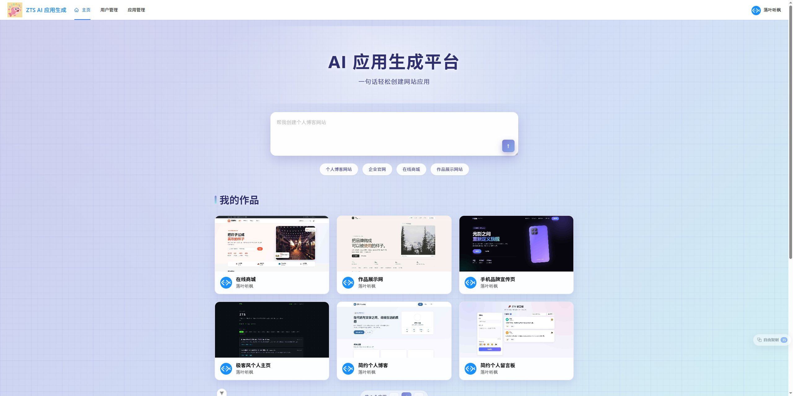
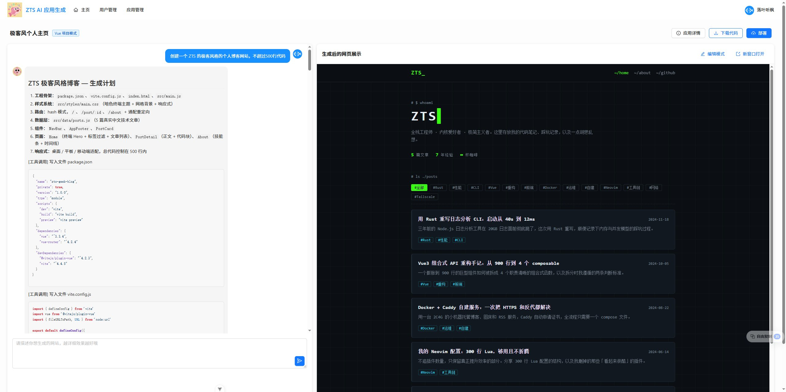
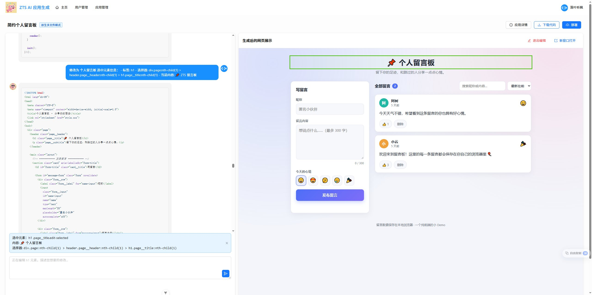
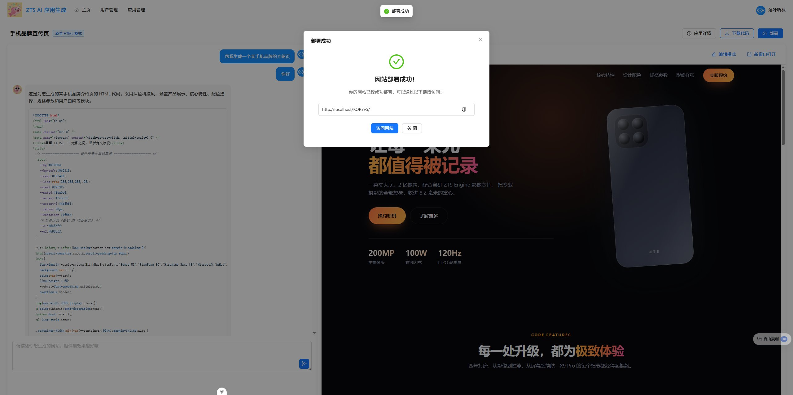
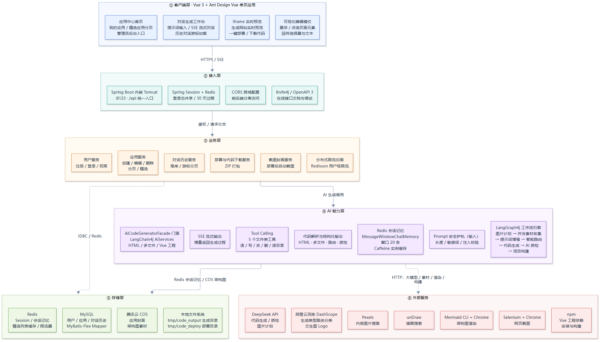
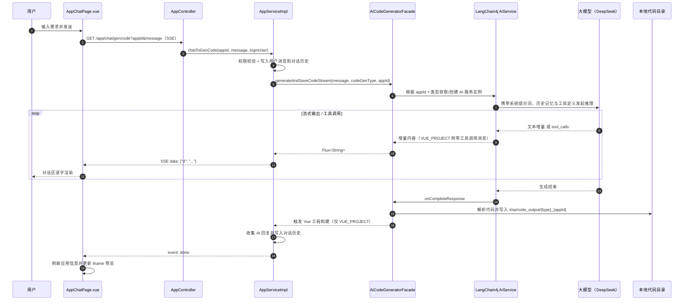
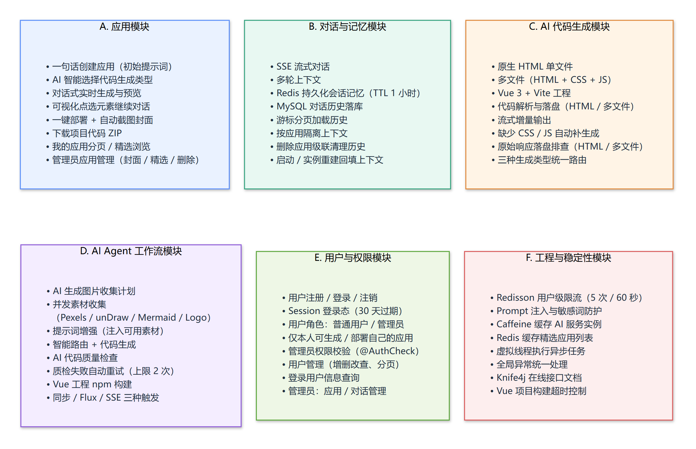
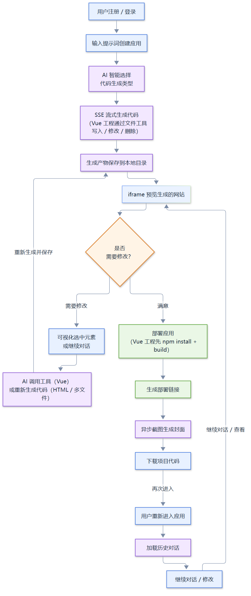

<h1 align="center">ZTS AI 零代码应用生成平台</h1>

> 一个基于 **Spring Boot 3 + LangChain4j + LangGraph4j + Vue 3** 的全栈 AI 应用生成平台：用户用自然语言描述需求，AI 自动选择生成方案、流式输出代码、即时预览、可视化修改，最终一键部署为可访问的 Web 应用。

<p align="left">
  
  
  
  
  
  
  
  
</p>

---

## 📖 项目简介

**ZTS AI 零代码应用生成平台**把「一句话生成网站」拆成一条真正可运行的工程链路，而不是一个只会输出代码片段的聊天 Demo：

- **智能路由**：创建应用时先由 AI 判断需求复杂度，自动选择 **HTML 单文件 / 多文件（HTML + CSS + JS）/ Vue 3 工程** 三种生成模式之一；
- **即时预览**：生成过程通过 SSE 流式回传，对话区逐字渲染；生成完成后右侧 iframe 立即预览结果；
- **可视化修改**：在预览里开启「编辑模式」，悬浮高亮、点击选中任意元素，平台把选择器、文本、页面路径拼进提示词；Vue 工程由 AI 调用文件工具精确修改，HTML / 多文件则按元素信息重新生成整份代码；
- **对话记忆**：多轮对话上下文按应用隔离，短期记忆存 Redis、完整历史落 MySQL，重新进入应用可继续上次的修改；
- **交付能力**：一键部署生成访问链接，Vue 工程会先执行 `npm install` + `npm run build`，部署后自动截图生成应用封面，也可以把项目打包成 ZIP 下载；
- **工作流编排**：基于 LangGraph4j 编排「图片计划 → 并发素材收集 → 提示词增强 → 智能路由 → 代码生成 → AI 质检 → 项目构建」，并带有质检失败重试上限与构建超时控制。

项目采用前后端分离：后端负责 AI 工作流编排、代码生成与落盘、部署、截图、权限与流量控制；前端是应用中心 + 对话式生成工作台 + 管理后台。

## **🖼️ 界面预览**

项目主要界面如下，对应「创建应用 → 智能生成 → 可视化修改 → 一键部署」的完整使用路径：

<div align="center">
	
	<sub>① 平台首页：一句话输入需求创建应用，下方展示「我的作品」与「精选案例」</sub>
</div>

<div align="center">
	
	<sub>② 智能代码生成：Vue 工程模式下先输出生成计划，再通过文件工具逐个写入 <code>package.json</code>、<code>vite.config.js</code> 等文件，右侧同步预览</sub>
</div>

<div align="center">
	
	<sub>③ 可视化编辑：点选页面元素后自动回传标签、CSS 选择器、页面路径与当前文本，继续对话即可精准修改</sub>
</div>

<div align="center">
	
	<sub>④ 一键部署：部署成功后展示访问链接（如 <code>http://localhost/KOR7vS/</code>），可直接打开网站分享给他人</sub>
</div>

## ✨ 项目特性

| 特性 | 说明 |
| --- | --- |
| 💬 一句话生成应用 | 首页输入需求即可创建应用，AI 自动路由到最合适的代码生成模式 |
| 🧱 三种生成模式 | 原生 HTML 单文件、HTML/CSS/JS 多文件、Vue 3 + Vite 工程项目，覆盖静态页面到多页面应用 |
| ⚡ SSE 流式输出 | 模型输出边生成边推送，前端逐字渲染 |
| 👁️ 即时预览 | 生成完成后在 iframe 中直接浏览，支持新窗口打开 |
| 🎯 可视化编辑 | 预览页内点击元素，自动提取选择器 / 文本 / 页面路径，继续对话完成精准修改 |
| 🧠 多轮记忆 | Redis 持久化会话记忆 + MySQL 存储对话历史，并按应用实现对话隔离 |
| 🛠️ 工具调用 | 5 个文件类工具（读文件 / 写文件 / 改文件 / 删文件 / 读目录），支撑 Vue 工程的多文件生成与修改 |
| 🕸️ Agent 工作流 | 基于 LangGraph4j 编排素材收集、提示词增强、代码生成、AI 质检与项目构建的工作流 |
| 🚀 一键部署 | 部署产物写入独立目录并生成 6 位访问标识；Vue 工程自动构建后再部署 |
| 🖼️ 封面自动化 | 部署后用 Selenium 无头浏览器截图、压缩并上传对象存储，自动回填应用封面 |
| 📦 代码下载 | 一键把生成目录打包为 ZIP（自动过滤 `node_modules`、`dist`、`.git` 等） |
| 🔐 用户与权限 | Session 登录态、本人 / 管理员权限校验、用户与应用管理后台 |
| 🛡️ 稳定性设计 | Redisson 用户级限流、Prompt 注入防护、实例缓存、全局异常处理（含 SSE 错误事件） |
| 📚 接口文档 | Knife4j / OpenAPI 3，开箱即用的在线调试界面 |

## 🏗️ 项目架构

### 架构设计图

整体自上而下分为 **客户端 → 接入层 → 业务层 → AI 能力层 → 存储层 → 外部服务** 六层，与本项目的实际包结构一一对应。



### 架构层与代码包对照

| 架构层 | 图中元素 | 对应代码位置 |
| --- | --- | --- |
| **客户端** | Vue 3 单页应用、对话页、iframe 预览、可视化编辑 | `zts-ai-code-mother-frontend/src/pages/app/AppChatPage.vue`、`zts-ai-code-mother-frontend/src/utils/visualEditor.ts` |
| **接入层** | 内嵌 Tomcat（:8123，`/api`）、Session、CORS、Knife4j | `ZtsAiCodeMotherApplication`、`config/CorsConfig`、`application.yaml` |
| **业务层** | 用户 / 应用 / 对话历史 / 部署下载 / 截图封面 / 限流 | `controller/`、`service/impl/`、`ratelimit/` |
| **AI 能力层** | AiServices、三种生成服务、SSE、Tool Calling、结构化输出、护轨、记忆、工作流 | `ai/`、`core/`、`langgraph4j/` |
| **存储层** | MySQL、Redis、腾讯云 COS、本地文件系统 | `mapper/`、`config/RedisChatMemoryStoreConfig`、`manager/CosManager`、`constant/AppConstant` |
| **外部服务** | DeepSeek、DashScope、Pexels、unDraw、Mermaid CLI、Selenium、npm | `config/*ChatModelConfig`、`langgraph4j/tools/`、`utils/WebScreenshotUtils`、`core/builder/VueProjectBuilder` |

### 核心请求时序图（以对话生成代码为例）



> 时序图以 HTML / 多文件模式为例；Vue 工程的代码由模型通过文件工具直接写入目录，流结束后只做构建与预览刷新。

### 后端分层

```
com.zts.ztsaicodemother
├── ai                         # AI 能力
│   ├── AiCodeGeneratorService            # LangChain4j AiService：HTML / 多文件 / Vue 工程
│   ├── AiCodeGeneratorServiceFactory     # 按 appId + 类型创建服务，Caffeine 缓存实例
│   ├── AiCodeGenTypeRoutingService       # 结构化输出：AI 智能选择生成类型
│   ├── guardrail/                        # Prompt 安全护轨（敏感词 + 注入模式 + 长度）
│   ├── model/                            # HtmlCodeResult、MultiFileCodeResult、流式消息体
│   └── tools/                            # BaseTool + ToolManager + 5 个文件类工具
├── core                       # 生成结果处理
│   ├── AiCodeGeneratorFacade             # 生成 + 解析 + 落盘的门面
│   ├── parser/                           # HTML / 多文件代码解析器
│   ├── saver/                            # 代码保存模板与执行器
│   ├── handler/                          # SSE 流的文本 / JSON 消息处理
│   └── builder/VueProjectBuilder         # npm install + npm run build + dist 校验
├── langgraph4j               # Agent 工作流
│   ├── CodeGenWorkflow                   # 串行工作流（素材并发收集 → 增强 → 路由 → 生成 → 质检 → 构建）
│   ├── CodeGenConcurrentWorkflow         # 图级并发工作流（4 路素材收集分支 → 聚合）
│   ├── node/                             # 各节点实现（含 node/concurrent 并发节点）
│   ├── ai/                               # 图片计划、素材收集、代码质检的 AiService
│   ├── tools/                            # Pexels / unDraw / Mermaid / Logo 素材工具
│   ├── model/、state/                    # 工作流上下文与结构化结果
├── controller                # App / User / ChatHistory / StaticResource / Workflow / Health
├── service、service/impl     # 应用、用户、对话历史、截图、项目下载
├── mapper、model             # MyBatis-Flex Mapper 与 DTO / Entity / VO / 枚举
├── config                    # 模型、Redis、缓存、COS、跨域、JSON 等配置
├── ratelimit                 # @RateLimit 注解 + Redisson 分布式限流切面
├── annotation、aop           # @AuthCheck 与权限拦截器
├── exception                 # 业务异常、错误码、全局异常处理（含 SSE 错误事件）
├── manager/CosManager        # 腾讯云 COS 上传
└── utils                     # 截图、缓存 Key、Spring 上下文等工具
```

## 🧩 功能模块



### 1. 应用管理

| 能力 | 实现要点 |
| --- | --- |
| 一句话创建应用 | 首页填写 `initPrompt`，后端取前 12 个字符作为默认应用名，创建成功即跳转对话页 |
| 生成类型智能路由 | `AiCodeGenTypeRoutingService` 用结构化输出直接返回 `CodeGenTypeEnum`，提示词见 `prompt/codegen-routing-system-prompt.txt` |
| 我的应用 | 按当前登录用户分页查询，支持应用名模糊搜索、排序字段白名单，每页最多 20 条 |
| 精选应用 | `priority = 99` 视为精选；分页接口带 `@Cacheable`，前 10 页结果缓存 5 分钟 |
| 应用详情 | 返回 `AppVO` 并关联创建者信息；列表接口批量查询用户，避免 N + 1 查询 |
| 修改应用 | 普通用户仅可改应用名；管理员可改应用名、封面、优先级 |
| 删除应用 | 仅本人或管理员可删，删除时级联清理该应用的对话历史 |
| 管理后台 | 应用管理页支持按名称 / 创建者 ID / 生成类型筛选，查看封面、部署时间、优先级并删除 |

### 2. AI 代码生成（三种模式）

| 模式 | 枚举值 | 模型与能力 | 产物 |
| --- | --- | --- | --- |
| 原生 HTML | `html` | 流式输出，单文件内联 CSS / JS | `tmp/code_output/html_{appId}/index.html` |
| 多文件 | `multi_file` | 流式输出，强制拆分为 `index.html`、`style.css`、`script.js` | `tmp/code_output/multi_file_{appId}/` 下三个文件 |
| Vue 工程 | `vue_project` | 推理模型 + 工具调用，**按文件逐步写入** | `tmp/code_output/vue_project_{appId}/` 完整工程 + 构建后的 `dist/` |

三种模式共用 `AiCodeGeneratorFacade` 作为统一入口，关键处理：

- **流式解析与落盘（HTML / 多文件）**：生成过程中持续累积内容，流结束后统一解析并写文件；出错时也会把已收到的半成品落盘，便于排查；
- **缺失文件补生成**：多文件模式下若解析结果缺少 CSS 或 JS，会用同一份对话记忆再向模型索取一次缺失文件（最多 1 次），补生成内容只用于补齐文件、不重复推送给前端；
- **原始响应落盘（HTML / 多文件）**：模型原始输出写入 `tmp/last_raw_{appId}.txt`，方便定位「模型没按格式输出」的问题；
- **Vue 工程由工具直接写文件**：模型通过文件工具逐个创建 / 修改文件，平台只透传文本与工具事件，流结束后执行构建；
- **Vue 工程构建**：`VueProjectBuilder` 在生成完成后同步执行 `npm install`（5 分钟超时）与 `npm run build`（3 分钟超时），并校验 `dist` 目录存在。

### 3. 对话与记忆

| 能力 | 实现要点 |
| --- | --- |
| SSE 流式对话 | `GET /app/chat/gen/code` 返回 `Flux<ServerSentEvent<String>>`，数据体包装为 `{"d": "增量"}`，结束时发送 `event: done` |
| 会话记忆 | 每个应用一份 `MessageWindowChatMemory`（窗口 20 条），底层用 `RedisChatMemoryStore` 持久化，TTL 1 小时 |
| 历史回填 | 创建 AI 服务实例时从 MySQL 读取最近 20 条历史并回填记忆，重进应用也能续上上下文 |
| 历史落库 | 用户消息在生成前写入；AI 回复在流结束后写入；失败时记录错误消息 |
| 游标分页 | `GET /chatHistory/app/{appId}` 以 `lastCreateTime` 为游标、每页默认 10 条（上限 50 条），前端「加载更多」按时间正序拼接 |
| 权限隔离 | 仅应用创建者与管理员可查看某个应用的对话历史 |
| VUE_PROJECT 特殊处理 | 流中同时包含文本、工具请求、工具执行结果，`JsonMessageStreamHandler` 会把工具调用渲染成可读步骤并汇总进历史 |

### 4. 网页预览与可视化编辑

- **预览地址**：`/api/static/{codeGenType}_{appId}/`；Vue 工程指向 `dist/index.html`；
- **编辑模式**：前端向预览 iframe 注入编辑脚本，悬浮显示虚线高亮、点击选中元素并显示绿色描边；
- **元素信息回传**：iframe 通过 `postMessage` 把标签名、`id` / `class`、文本片段、CSS 选择器、页面路径回传给父页面；
- **提示词增强**：发送下一条消息时自动附加「选中元素信息」；Vue 工程由 AI 调用文件修改工具做最小改动，HTML / 多文件则按元素信息重新生成整份代码；
- **交互细节**：选中元素后发送消息会自动清除选中态并退出编辑模式；非应用创建者只读预览、不能对话。

### 5. 部署、封面与代码下载

| 能力 | 实现要点 |
| --- | --- |
| 一键部署 | 首次部署生成 6 位 `deployKey`；Vue 工程先构建再部署，其他类型直接复制生成目录 |
| 部署目录 | 产物复制到 `tmp/code_deploy/{deployKey}`，访问地址由部署域名 + `deployKey` 拼接 |
| 部署记录 | 回填 `deployKey` 与 `deployedTime`，前端弹窗展示访问链接并支持直接打开 |
| 自动封面 | 虚拟线程异步截图（Selenium + 无头 Chrome，1600×900，等待 `document.readyState`）→ 压缩为 JPG → 上传腾讯云 COS → 回填 `cover` |
| 代码下载 | 仅应用创建者可下载；Hutool 边打包边输出到响应流，自动过滤 `node_modules`、`dist`、`.git`、`.env` 等 |

> **部署访问说明**：部署只负责把产物复制到 `tmp/code_deploy` 并生成访问地址，`AppConstant.CODE_DEPLOY_HOST`（默认 `http://localhost`）需要指向该目录对应的静态服务，才能通过返回的链接访问。

### 6. LangGraph4j AI Agent 工作流

工作流有两套实现，节点都实现为 `AsyncNodeAction`，状态通过 `WorkflowContext` 在节点间传递：

**① `CodeGenWorkflow`（`/workflow` 接口实际执行的版本）**

```
素材收集（AI 生成图片计划 + CompletableFuture 并发收集）→ 提示词增强 → 智能路由 → 代码生成 → AI 代码质检
                                                                                        ├─ 通过且需构建 → 项目构建 → END
                                                                                        ├─ 通过且无需构建 → END
                                                                                        ├─ 失败 → 回到代码生成（带错误修复提示词）
                                                                                        └─ 连续失败超限 → give_up 终止
```

**② `CodeGenConcurrentWorkflow`（图级并发版本）**

```
图片计划 ─┬─ 内容图收集 ─┐
          ├─ 插画收集   ─┤
          ├─ 架构图收集 ─┼→ 图片聚合 → 提示词增强 → 智能路由 → 代码生成 → AI 质检 →（同上条件边）
          └─ Logo 收集  ─┘
```

| 节点 | 作用 |
| --- | --- |
| `ImageCollectorNode` | 串行工作流中的素材节点：先让 AI 产出计划，再用 `CompletableFuture` 并发执行各类收集 |
| `ImagePlanNode` | 并发工作流入口：让 AI 分析需求，产出内容图 / 插画 / 架构图 / Logo 四类收集计划 |
| 4 个并发收集节点 | ContentImage（Pexels）、Illustration（unDraw）、Diagram（Mermaid CLI 渲染 + COS 上传）、Logo（DashScope 文生图）并行执行 |
| `ImageAggregatorNode` | 汇总四路素材结果 |
| `PromptEnhancerNode` | 把可用素材（类别、描述、URL）追加进提示词，要求生成时合理嵌入 |
| `RouterNode` | 智能选择代码生成类型，异常时降级为 HTML |
| `CodeGeneratorNode` | 调用统一生成门面，最长等待 10 分钟 |
| `CodeQualityCheckNode` | 读取生成目录下的代码文件（跳过 `node_modules` / `dist` / `.git`），交给 AI 质检并返回 `QualityResult` |
| `ProjectBuilderNode` | Vue 工程执行构建，产出 `dist` 目录 |

工程化细节：

- **质检重试上限**：质检失败会带着错误与修复建议回到代码生成，最多重试 2 次后返回 `give_up`，避免「质检失败 → 重新生成」死循环；
- **并发执行**：`CodeGenConcurrentWorkflow` 为 4 路素材收集配置独立线程池（核心 10 / 最大 20），由 LangGraph4j 的并行节点执行器调度；
- **三种触发方式**：`POST /workflow/execute` 同步返回上下文、`GET /workflow/execute-flux` 返回 Flux、`GET /workflow/execute-sse` 返回 `SseEmitter`，事件包括 `workflow_start`、`step_completed`、`workflow_completed`、`workflow_error`；
- **当前入口**：`/workflow/**` 执行的是 `CodeGenWorkflow`；`CodeGenConcurrentWorkflow` 目前通过工作流测试验证，尚未单独暴露 HTTP 接口。主站对话生成走 `/app/chat/gen/code`。

### 7. 用户与权限

| 能力 | 实现要点 |
| --- | --- |
| 注册 / 登录 / 注销 | 账号密码注册（两次密码校验）、登录后写入 Session、注销清理登录态 |
| Session 共享 | `spring-session-data-redis`，Cookie 与 Session 均为 30 天过期 |
| 登录态查询 | `GET /user/get/login` 供前端全局路由守卫使用 |
| 权限校验 | `@AuthCheck(mustRole = "admin")` + AOP 拦截器；业务层再校验资源归属（仅本人可生成 / 部署 / 下载） |
| 用户管理 | 管理员可新增（默认密码 `12345678`）、删除、修改、分页查询；分页与 VO 接口返回脱敏后的 `UserVO` |
| 前端守卫 | `/admin/**` 路由在 `access.ts` 中统一拦截，非管理员跳转登录页 |

### 8. 稳定性与工程优化

| 优化点 | 实现 |
| --- | --- |
| 分布式限流 | `@RateLimit` + Redisson `RRateLimiter`，对话生成接口按用户 5 次 / 60 秒限流，超限返回 42900 并通过 SSE `business-error` 事件提示前端 |
| Prompt 安全 | `PromptSafetyInputGuardrail` 校验长度、空输入、敏感词与常见注入模式，命中直接拒绝 |
| 实例缓存 | `AiCodeGeneratorServiceFactory` 用 Caffeine 缓存 AI 服务实例（最多 1000 个，写入 30 分钟 / 访问 10 分钟过期） |
| 结果缓存 | 精选应用分页结果走 Redis 缓存，`good_app_page` 5 分钟过期 |
| 异步任务 | 截图使用虚拟线程执行，不阻塞部署响应；工作流流式接口同样运行在虚拟线程中 |
| 构建超时 | `npm install` 5 分钟、`npm run build` 3 分钟，超时强制终止进程 |
| 异常处理 | `GlobalExceptionHandler` 统一错误码；SSE 请求异常时改写为 `business-error` + `done` 事件，前端可展示具体原因 |
| 接口文档 | Knife4j 扫描 `controller` 包，`/api/doc.html` 在线调试 |

## 🔄 核心业务流程



1. **注册 / 登录**：登录态写入 Redis Session，前端路由守卫据此判断权限；
2. **创建应用**：输入自然语言需求，AI 结构化输出选择生成模式；
3. **流式生成**：SSE 连接建立后，模型边推理边输出；Vue 工程模式下模型通过文件工具逐个创建 / 修改文件；
4. **产物保存**：HTML / 多文件在流结束后解析并写入 `tmp/code_output`；Vue 工程由文件工具直接写入目录，流结束后自动构建；
5. **实时预览**：右侧 iframe 加载静态预览地址；
6. **修改闭环**：需要修改时，可开启编辑模式点选元素，或直接继续对话；Vue 工程由 AI 调用文件工具修改，HTML / 多文件重新生成整份代码，再回到预览；
7. **部署交付**：满意后一键部署，生成访问链接，异步截图回填封面，并支持下载 ZIP；
8. **再次进入**：重新打开应用时先加载历史对话与上下文，继续迭代。

## 🛠️ 技术选型

### 后端

| 技术 | 版本 | 选型理由 |
| --- | --- | --- |
| Java | 21 | LTS，使用虚拟线程执行截图、工作流等异步任务 |
| Spring Boot | 3.5.4 | 自动装配、Web / SSE、Session 支持完善 |
| LangChain4j | 1.1.0 | `AiServices` + 声明式接口 + 工具调用 + 护轨，代码量小、可读性高 |
| LangChain4j OpenAI Starter | 1.1.0-beta7 | 用 OpenAI 兼容协议同时对接 DeepSeek 与 DashScope 兼容模式 |
| LangGraph4j | 1.6.0-rc2 | 有状态图编排、条件边、并行节点执行器 |
| MyBatis-Flex | 1.11.0 | 轻量 ORM，`QueryWrapper` 拼装灵活，自带代码生成 |
| MySQL | 8.x | 用户、应用、对话历史持久化 |
| Redis | 6.x+ | Session、会话记忆、结果缓存、分布式限流 |
| Redisson | 3.50.0 | 分布式限流器实现 |
| Spring Session Data Redis | - | 登录态跨实例共享 |
| Caffeine | - | 本地缓存 AI 服务实例，降低重复构建开销 |
| Selenium + WebDriverManager | 4.33.0 / 6.1.0 | 无头 Chrome 自动截图，驱动自动管理 |
| 腾讯云 COS SDK | 5.6.227 | 应用封面截图、架构图等素材对象存储 |
| DashScope SDK | 2.21.1 | 文生图（Logo）与兼容模式路由模型 |
| Hutool | 5.8.38 | HTTP、文件、ZIP、JSON、线程池等工具 |
| Knife4j | 4.4.0 | 基于 OpenAPI 3 的中文接口调试界面 |
| Lombok | 1.18.36 | 消除样板代码 |

### 前端

| 技术 | 版本 | 选型理由 |
| --- | --- | --- |
| Vue | 3.5 | 组合式 API + `<script setup>`，组件拆分成本低 |
| TypeScript | 5.8 | 接口与流式消息类型清晰 |
| Vite | 7 | 冷启动快，`/api` 开发代理开箱即用 |
| Ant Design Vue | 4.2 | 表格、表单、弹窗等后台组件齐全 |
| Pinia | 3 | 登录用户状态管理 |
| Vue Router | 4 | 路由与管理员守卫 |
| markdown-it + highlight.js | - | 对话区 Markdown 与代码高亮渲染 |
| Axios | 1.11 | 统一请求封装与错误转换 |

### 关键技术决策

| 决策 | 取舍说明 |
| --- | --- |
| **按应用实例化 AI 服务** | LangChain4j 的 `AiService` 与对话记忆绑定，按 `appId + 生成类型` 创建实例并用 Caffeine 缓存，既保证上下文隔离，又避免重复创建 |
| **三种生成模式而非一刀切** | 简单页面用单文件最快、多文件便于维护、Vue 工程支持多页面与复杂交互；由 AI 路由比让用户手选更省心 |
| **工具调用 + 文件落盘** | Vue 工程文件多、单次输出容易超限，交给模型调用文件工具「逐个写」，比一次性输出整包更稳 |
| **SSE 而非 WebSocket** | 生成是一问多答的单向推送场景，SSE 基于 HTTP，接入简单，且能复用现有鉴权与限流 |
| **Redis 存记忆 + MySQL 存历史** | 记忆需要高频读写与 TTL，历史需要长期留存与游标分页，两者职责分离 |
| **显式指定 JDK HttpClient** | 默认的 Apache HttpClient 会声明 Brotli，DeepSeek 边缘节点因此返回 `content-encoding: br`，导致 JSON 流被截断；改用 JDK HttpClient 后直接拿到明文 JSON / SSE |
| **工作流与主流程解耦** | 工作流先以独立 `/workflow` 接口跑通，便于验证节点、并发与重试策略，再逐步接入业务 |

## 📁 目录结构

```
zts-ai-code-mother/
├── src/main/java/com/zts/ztsaicodemother/   # 后端源码
│   ├── ai/                                  # AiService、路由、护轨、工具、消息体
│   ├── core/                                # 生成门面、解析、保存、流处理、Vue 构建
│   ├── langgraph4j/                         # Agent 工作流与素材工具
│   ├── controller/                          # App / User / ChatHistory / StaticResource / Workflow
│   ├── service/                             # 业务服务与实现
│   ├── mapper/、model/                       # 持久层与数据模型
│   ├── config/                              # 模型、Redis、缓存、COS、跨域
│   ├── ratelimit/、annotation/、aop/         # 限流与权限
│   └── exception/、common/、utils/           # 异常、统一响应、工具
├── src/main/resources/
│   ├── application.yaml                     # 主配置（端口、MySQL、Redis、Knife4j）
│   ├── application-local.yaml               # 本地模型 / COS / 素材密钥（已被 git 忽略）
│   ├── application-prod-sample.yaml         # 生产环境配置示例（模型部分）
│   ├── prompt/                              # 系统提示词（HTML / 多文件 / Vue / 路由 / 质检 / 素材）
│   └── static/                              # 工作流 Flux / SSE 演示页
├── src/test/java/                           # 解析、保存、路由、工作流、截图等单元测试
├── sql/create_table.sql                     # 建库建表脚本
├── docs/diagrams/                           # 三幅图的 Mermaid 源码与 PNG / SVG
├── docs/images/                             # 界面截图（首页 / 智能生成 / 可视化编辑 / 部署）
├── zts-ai-code-mother-frontend/             # 前端（Vue 3 + Vite）
│   ├── src/pages/                           # 首页、对话页、编辑页、登录注册、管理后台
│   ├── src/components/                      # AppCard、MarkdownRenderer、部署弹窗等
│   ├── src/api/、stores/、router/、utils/   # 接口、状态、路由、可视化编辑
│   └── vite.config.ts                       # 开发代理 /api → :8123
├── tmp/                                     # 运行期生成物（git 忽略）
│   ├── code_output/                         # 生成的代码目录
│   ├── code_deploy/                         # 部署产物目录
│   └── screenshots/                         # 截图临时目录
├── pom.xml
└── README.md
```

## 🚀 快速开始

### 环境要求

| 依赖 | 版本要求 | 用途 |
| --- | --- | --- |
| JDK | 21+ | 后端运行 |
| Maven | 3.8+ | 构建（也可用项目自带 `mvnw`） |
| MySQL | 8.x | 业务数据存储 |
| Redis | 6.x+ | Session / 记忆 / 缓存 / 限流 |
| Node.js | 20.19+ 或 22.12+（Vite 7 要求） | 前端开发；Vue 工程生成后构建 |
| Chrome | 任意较新版本 | 部署后自动截图；Mermaid 架构图渲染 |
| Mermaid CLI | 可选 | 工作流「架构图」素材需要 `mmdc` 命令 |

### 1. 初始化数据库

```bash
mysql -uroot -p < sql/create_table.sql
```

脚本会创建 `zts_ai_code_mother` 库以及 `user`、`app`、`chat_history` 三张表。

### 2. 准备外部服务

| 服务 | 用途 | 获取地址 |
| --- | --- | --- |
| DeepSeek | 代码生成、质检、图片计划 | <https://platform.deepseek.com/> |
| 阿里云百炼 DashScope | 生成类型路由、文生图 Logo | <https://bailian.console.aliyun.com/> |
| 腾讯云 COS | 封面与素材存储 | <https://console.cloud.tencent.com/cos> |
| Pexels | 内容图片搜索 | <https://www.pexels.com/api/> |

### 3. 创建本地配置

`application-local.yaml` 已被 `.gitignore` 忽略，需要自行创建 `src/main/resources/application-local.yaml`：

```yaml
langchain4j:
  open-ai:
    chat-model:
      base-url: https://api.deepseek.com
      api-key: 你的 DeepSeek Key
      model-name: deepseek-flash
      max-tokens: 8192
      strict-json-schema: true
    streaming-chat-model:
      base-url: https://api.deepseek.com
      api-key: 你的 DeepSeek Key
      model-name: deepseek-flash
      max-tokens: 131072
    reasoning-streaming-chat-model:      # Vue 工程生成使用
      base-url: https://api.deepseek.com
      api-key: 你的 DeepSeek Key
      model-name: deepseek-flash
      max-tokens: 32768
      temperature: 0.1
    routing-chat-model:                  # 生成类型路由使用
      base-url: https://dashscope.aliyuncs.com/compatible-mode/v1
      api-key: 你的 DashScope Key
      model-name: qwen3.7-flash
      max-tokens: 100

cos:
  client:
    host: https://你的桶名.cos.ap-nanjing.myqcloud.com
    secretId: 你的 SecretId
    secretKey: 你的 SecretKey
    region: ap-nanjing
    bucket: 你的桶名

pexels:
  api-key: 你的 Pexels Key

dashscope:
  api-key: 你的 DashScope Key
  image-model: wan2.2-t2i-flash
```

> 数据库与 Redis 连接在 `application.yaml` 中，默认 `jdbc:mysql://localhost:3306/zts_ai_code_mother`、`localhost:6379`，按需修改。

### 4. 启动后端

```bash
# Windows
mvnw.cmd spring-boot:run

# macOS / Linux
./mvnw spring-boot:run
```

启动后：

- 接口根地址：<http://localhost:8123/api>
- Knife4j 文档：<http://localhost:8123/api/doc.html>
- 健康检查：<http://localhost:8123/api/health/>

### 5. 启动前端

```bash
cd zts-ai-code-mother-frontend
npm install
npm run dev
```

Vite 开发服务器默认把 `/api` 代理到 `http://localhost:8123`，打开终端提示的地址即可进入应用中心。

如需自定义后端 / 部署域名，可在 `zts-ai-code-mother-frontend/` 下创建 `.env.local`：

```bash
VITE_API_BASE_URL=http://localhost:8123/api
VITE_DEPLOY_DOMAIN=http://localhost
```

### 6. 生产构建

```bash
cd zts-ai-code-mother-frontend
npm run build       # 类型检查 + 打包，产物在 dist/
npm run preview     # 本地预览构建产物
```

## 🔌 接口一览

后端统一前缀 `/api`（`server.servlet.context-path`）。

### 应用

| 方法 | 路径 | 说明 |
| --- | --- | --- |
| GET | `/app/chat/gen/code` | 对话式生成代码（SSE，按用户 5 次 / 60 秒限流） |
| POST | `/app/deploy` | 部署应用，返回访问地址 |
| GET | `/app/download/{appId}` | 下载应用代码 ZIP（仅创建者） |
| POST | `/app/add` | 创建应用 |
| POST | `/app/update` | 修改自己的应用（名称） |
| POST | `/app/delete` | 删除自己的应用（本人或管理员） |
| GET | `/app/get/vo` | 应用详情 |
| POST | `/app/my/list/page/vo` | 我的应用分页 |
| POST | `/app/good/list/page/vo` | 精选应用分页 |
| POST | `/app/admin/delete` | 管理员删除任意应用 |
| POST | `/app/admin/update` | 管理员修改名称 / 封面 / 优先级 |
| POST | `/app/admin/list/page/vo` | 管理员分页查询应用 |
| GET | `/app/admin/get/vo` | 管理员查看应用详情 |

### 用户 / 对话历史 / 静态资源 / 工作流

| 方法 | 路径 | 说明 |
| --- | --- | --- |
| POST | `/user/register`、`/user/login`、`/user/logout` | 注册、登录、注销 |
| GET | `/user/get/login` | 获取当前登录用户 |
| POST | `/user/add`、`/user/delete`、`/user/update`、`/user/list/page/vo` | 管理员用户管理 |
| GET | `/user/get`、`/user/get/vo` | 查询用户（`/get` 需管理员；`/get/vo` 返回脱敏信息） |
| GET | `/chatHistory/app/{appId}` | 应用对话历史（游标分页） |
| POST | `/chatHistory/admin/list/page/vo` | 管理员查询全部对话 |
| GET | `/static/{codeGenType}_{appId}/**` | 生成结果的静态预览（默认返回 `index.html`；路径是生成目录名，不是部署 key） |
| POST | `/workflow/execute` | 同步执行 LangGraph4j 工作流 |
| GET | `/workflow/execute-flux` | 工作流 Flux 流式输出 |
| GET | `/workflow/execute-sse` | 工作流 SSE 流式输出 |
| GET | `/health/` | 健康检查 |

### SSE 消息约定

| 事件 / 数据 | 含义 | 前端表现 |
| --- | --- | --- |
| `data: {"d": "..."}` | 模型增量文本 | 逐字追加到当前 AI 气泡 |
| `event: done` | 生成结束 | 关闭连接、刷新应用信息并更新预览 |
| `event: business-error` | 业务异常（如限流、参数错误） | 气泡内展示错误信息并提示 |
| `event: workflow_start / step_completed / workflow_completed / workflow_error` | 工作流生命周期事件 | 工作流演示页按步骤展示 |

**请求示例：**

```bash
curl -N "http://localhost:8123/api/app/chat/gen/code?appId=1&message=帮我做一个个人博客网站"
```

## 🧠 关键实现细节

- **AiService 多例与缓存**：`AiCodeGeneratorServiceFactory` 以 `appId + codeGenType` 为 key 缓存实例；Vue 工程走推理模型 + 工具调用，HTML / 多文件走普通流式模型。
- **结构化输出**：生成类型路由（`CodeGenTypeEnum`）、代码质检（`QualityResult`）、图片收集计划（`ImageCollectionPlan`）都通过 LangChain4j 的结构化输出直接映射为 Java 枚举 / 对象；HTML 与多文件流式生成则按 Markdown 代码块解析（`CodeParserExecutor`）。
- **JSON 流重组**：Vue 工程使用 LangChain4j `TokenStream`，`onPartialResponse` / `onPartialToolExecutionRequest` / `onToolExecuted` 分别产出文本、工具请求、工具结果三类消息，前端按类型渲染。
- **工具注册**：所有文件工具继承 `BaseTool`，`ToolManager` 在启动时自动收集并注册；`generateToolRequestResponse` / `generateToolExecutedResult` 决定工具调用在对话中的展示文案与历史内容。
- **重试与兜底**：多文件缺文件补生成、质检失败重试、模型空响应跳过保存、异常时保留半成品，都是针对真实模型输出不稳定做的工程化处理。
- **流式错误协议**：SSE 场景下异常不能返回普通 JSON，`GlobalExceptionHandler` 会改写为 `business-error` 事件再补一个 `done`，保证前端总能收尾。
- **安全边界**：提示词护轨拦截注入；接口层做参数校验、权限校验与限流；下载与历史查询都校验资源归属。

## ❓ 常见问题

<details>
<summary><b>启动后模型调用报 JSON 解析错误 / 响应被截断？</b></summary>
本项目已通过 <code>LangChain4jHttpClientConfig</code> 把 HTTP 客户端显式覆盖为 JDK HttpClient，避免 Apache HttpClient 声明 Brotli 后 DeepSeek 返回压缩响应导致 JSON 被截断。若你新增了模型配置，请同样指定 <code>JdkHttpClient.builder()</code>。
</details>

<details>
<summary><b>生成 Vue 工程时构建失败？</b></summary>
确认本机已安装 Node.js 与 npm，且 <code>npm</code> 在 PATH 中可执行；<code>VueProjectBuilder</code> 会依次执行 <code>npm install</code>（5 分钟超时）与 <code>npm run build</code>（3 分钟超时），失败时日志会打印退出码。网络较慢时可先配置 npm 镜像。
</details>

<details>
<summary><b>部署成功了但访问链接打不开？</b></summary>
部署只负责把产物复制到 <code>tmp/code_deploy/{deployKey}</code> 并用 <code>AppConstant.CODE_DEPLOY_HOST</code>（默认 <code>http://localhost</code>）拼接地址。请确认该域名 / 端口对应的静态服务已经指向部署目录。开发阶段可直接用预览地址 <code>/api/static/{codeGenType}_{appId}/</code> 查看效果。
</details>

<details>
<summary><b>部署后没有生成封面？</b></summary>
封面依赖 Selenium + 无头 Chrome。请确认已安装 Chrome、<code>WebDriverManager</code> 能下载到匹配的 ChromeDriver，并且截图目标地址可访问；截图在虚拟线程中异步执行，失败只影响封面，不影响部署结果。
</details>

<details>
<summary><b>对话提示「请求过于频繁」？</b></summary>
生成接口默认按用户 5 次 / 60 秒限流（Redisson）。等待窗口过去即可，或调整 <code>AppController#chatToGenCode</code> 上 <code>@RateLimit</code> 的 <code>rate</code> / <code>rateInterval</code>。
</details>

<details>
<summary><b>工作流里的 Mermaid 架构图生成失败？</b></summary>
该素材依赖全局 <code>mmdc</code>（Mermaid CLI）与 Chrome，且 <code>MermaidDiagramTool</code> 中配置了 Chrome 路径。请先执行 <code>npm install -g @mermaid-js/mermaid-cli</code> 并确认 Chrome 安装路径与代码一致。
</details>

<details>
<summary><b>重新进入应用后上下文丢失？</b></summary>
记忆存 Redis（TTL 1 小时），历史存 MySQL。若 Redis 数据过期，平台会在创建服务实例时从 <code>chat_history</code> 表回填最近 20 条，因此只要历史表有数据，上下文仍可恢复。
</details>

## 🔐 安全提醒

- `application-local.yaml` 已被 `.gitignore` 忽略，**请勿把任何真实密钥提交到 Git 仓库**；
- 若密钥曾经进入版本历史，建议立即到对应控制台**重置密钥**；
- 生产环境请修改默认数据库口令、为 COS 使用最小权限子账号，并为部署域名配置 HTTPS。

---

**如果这个项目对你有帮助，欢迎点一个 ⭐ Star 支持一下！**
